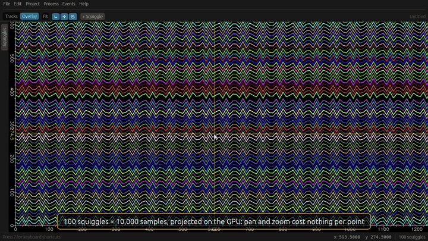

# Squiggle

An interactive waveform plotter built on [Bevy](https://bevy.org). Pan, zoom
and pick your way around hundreds of high-density polylines at once, then run
them through Fourier and wavelet transforms without leaving the plot.

[](docs/media/showcase.mp4)

*Highlights; click for the [full tour](docs/media/showcase.mp4) (4:44).*

## Features

- **Fast at scale.** Samples are uploaded to the GPU once and projected in a
  vertex shader, so panning and zooming cost nothing per point. A hundred
  squiggles of ten thousand samples each stay smooth.
- **Stacked multi-sensor tracks.** Traces from different sensors share one
  time axis, from 1 px/day to 10 ps/px, so a 40 Hz seismometer and a
  1 GS/s capture line up. A min/max level-of-detail pyramid keeps tens of
  millions of samples per trace interactive.
- **Seismic, RF and digitizer formats.** miniSEED (Steim1/2), SAC, SigMF
  (complex I/Q), WAV, CSV and raw binary with a described layout.
- **Preprocessing.** Detrend, taper and Butterworth filters (low-, high-,
  band-pass, band-stop; zero-phase or causal) per trace, saved in the project.
- **Alignment.** Cross-correlation or GCC-PHAT delays between traces at any
  rates, reconciled across all pairs by least squares, reviewed before
  applying. Manual shifts by drag (snapping to correlation peaks) or by
  sample. Every edit undoes.
- **Picking and location.** STA/LTA onsets refined by AIC, manual picks by
  key, and a grid-search locator over position, depth and origin time that
  mixes phenomenologies (EMP anchors the origin, slower phases resolve
  position). Moveout removal and pick alignment line up arrivals across
  phenomenologies.
- **Events.** Streaming detectors (STA/LTA, energy, kurtosis) on every track,
  association across sensors with coincidence windows from each
  phenomenology's propagation, located and outlier-pruned; a catalogue to
  review, accept, reject, split and merge; events brushed by hand. Each event
  carries its own members, offsets, picks and origin.
- **Classification.** Per-member and per-event features (time domain,
  spectral, wavelet, across sensors) and earthquake/explosion discriminants
  (P/S ratio, spectral ratio, first motion, depth, coupled air and EM
  arrivals); a transparent rules classifier; an extensible label taxonomy
  seeded with earthquake, explosion and other; a review queue ordered by
  uncertainty and model disagreement; training datasets exported as Parquet.
- **Offline models.** `squiggle-train` fits logistic regression, linear SVM,
  kNN, a decision tree or a random forest to exported features, or a CNN
  (burn) to exported waveform windows with one branch per phenomenology and
  late or early fusion, and writes a checksummed model package; ONNX models
  can be packaged too. The app imports packages and runs inference only,
  recording each model's prediction on every event and combining them in a
  weighted ensemble.
- **Live feeds.** A framed TCP stream (`heidtmare.squiggle.stream/1`) is
  recorded to disk as it arrives, plotted as it grows (level of detail
  appended, never rebuilt), followed at the right edge, and detected on a
  sliding window: each event is added once no later arrival could change it,
  giving exactly the events of the whole recording. `squiggle-stream`
  replays files as a feed.
- **Shared projects.** `squiggle-server` holds shared projects and the files
  behind them (`heidtmare.squiggle.sync/1`). Analysts work offline and sync
  edits both ways; edits merge per field, the later one winning, except where
  an analyst's judgement (a locked alignment, a manual pick, a reviewed event)
  meets a concurrent edit, which is held as a conflict for a person to settle.
- **Similarity and clusters.** A template library curated by analysts:
  events match templates by network cross-correlation, which votes their
  labels, and a matched filter finds weak repeats. An offline PCA and DBSCAN
  embedding, imported like a model, plots events in a scatter view where a
  lasso labels a cluster in one step. Analyst agreement is tracked per model
  version.
- **Spectrogram strips** per row, two-sided for I/Q.
- **Independent axis zoom.** Zoom x and y together or separately, anchored on
  the point under the cursor — waveform axes rarely share a unit.
- **Even strokes at any zoom.** Lines are widened in screen space after
  projection, so they keep the same thickness however the axes are stretched.
- **Linear and logarithmic axes**, with ticks and labels that follow the view.
- **Exact picking.** Click a line to select it and see its individual samples.
- **Signal transforms.** Fourier, DFT, FFT, STFT, inverse Fourier and wavelet
  decompositions, with the results plotted alongside the source.
- **Self-checking demos** that run each transform on a signal with a known
  answer and show the numerical checks next to the picture.

## Running

```sh
cargo run -p squiggle-app --release
```

The plot starts empty; **Add Squiggle** puts one on it. To start with a full
plot instead:

```sh
cargo run -p squiggle-app --release -- --squiggles 100 --samples 10000
```

`--release` matters: a debug build is usable but not smooth. The workspace
already compiles dependencies with optimizations in dev profiles.

| Flag | Effect |
| --- | --- |
| `--project FILE` | Open a `.squiggle` project |
| `--synthetic` | Start with a synthetic event of known delays (see [Alignment](#alignment)) |
| `--located` | Start with a synthetic EMP, seismic and infrasound event of known source (see [Picking and location](#picking-and-location)) |
| `--swarm` | Start with two minutes of synthetic seismic data holding six events and glitches (see [Events](#events)) |
| `--mixed` | Start with seven minutes of synthetic earthquakes and explosions on seismic and infrasound sensors (see [Classification](#classification)) |
| `--catalogue` | Start with 27 minutes of 40 varied synthetic earthquakes and explosions on the same sensors, for training (see [Models](#models)) |
| `--families` | Start with 16 minutes of repeats from two quarries and two earthquake swarms, one weak repeat each (see [Templates and clusters](#templates-and-clusters)) |
| `--live HOST:PORT` | Connect to a live feed (see [Live feeds](#live-feeds)) |
| `--live-demo` | Start with the event families replayed live at ×10 |
| `--analyst NAME` | Record edits as `NAME` (default `$SQUIGGLE_ANALYST`, else the OS user) |
| `--server HOST:PORT` | Open the Shared Project window on this sync server (see [Shared projects](#shared-projects)) |
| `WAVEFORM...` | Import these files (any format below) |
| `--squiggles N` | Start with `N` demo squiggles |
| `--samples N` | Samples per demo squiggle |
| `--demo fourier\|wavelet` | Load a transform demo at startup |
| `--screenshot FILE` | Save the window once the plot settles, then quit |
| `--tour SCRIPT` | Drive the app with a scripted tour, headless, then quit (see [`tour.rs`](squiggle-app/src/tour.rs)) |
| `--record OUT.mp4` | Record the tour at 1080p30 (needs `ffmpeg`); `docs/media/record.sh` makes the showcase |

## Using it

The toolbar switches between two views. **Tracks** shows imported traces,
one row each, on a shared time axis; it opens when traces are loaded.
**Overlay** shows free squiggles: demos and transform results.

| Tracks | Control |
| --- | --- |
| Zoom time about the cursor | Scroll |
| Pan time / scroll rows | Drag, or horizontal scroll / scroll over the labels |
| Scale amplitude (all rows) | Pinch, or `Control` + scroll |
| Select a track | Click its row or label |
| Waveform / spectrogram / both, FFT size, y scale, I/Q component | Right-click a row |
| Alignment reference, lock / unlock / reset offset | Right-click a row |
| Shift a track in time | `Shift` + drag its row (`Alt` disables snapping) |
| Pick first phase / S at the cursor | `P` / `S` over a row |
| Remove the nearest pick | `Delete` or `Backspace` over a row; or right-click the row |
| Make an event | `⌘` / `Ctrl` + drag across the tracks (members: selected rows, else every row in the span) |
| Resize the reviewed event | Drag its window edge |
| Split it, add or remove a member | Right-click a row |
| Next / previous event, accept, reject, close | `]` / `[`, `A`, `R`, `Esc` while reviewing |
| Label the reviewed event | `1`–`9` (taxonomy order, see **Events ▸ Labels…**) |
| Nudge selected tracks | `←` / `→` one sample, with `Shift` ten |
| Frame every trace | **Fit**, or double-click |
| Order rows | **Rows by** in the toolbar |
| Plot without processing | **Raw** in the toolbar |
| Undo / redo | `⌘Z` / `⇧⌘Z` (`Ctrl` elsewhere), or **Edit** |

The gold cursor spans every row; its time is shown on the axis, and its UTC
time and the pixel size at the top right. A row's second line shows its
distance from the saved origin; its third line shows its offset (`Δ`, 🔒 when
locked) and processing; the reference is marked ★. Picks are solid lines
(white manual, blue automatic); arrivals predicted from the saved origin are
dashed green.

| Overlay | Control |
| --- | --- |
| Pan | Drag with the left mouse button |
| Zoom both axes | Scroll |
| Zoom y only | `Alt` + scroll |
| Zoom x only | `Control` + scroll |
| Select a squiggle | Click it — its samples appear as dots |
| Add a demo squiggle | **Add Squiggle** in the toolbar |
| Frame everything | **Fit** in the toolbar |
| List and delete squiggles | The **Squiggles** sidebar handle on the left |
| Delete the selection | **Edit ▸ Delete selected** |
| Transform a squiggle | Select it, then pick from the **Transform** menu |

Zoom is multiplicative, so each scroll notch changes the scale by the same
ratio at every magnification. When a squiggle is selected, sample dots closer
than six pixels apart are thinned so dense data stays readable.

## Projects

A project (`.squiggle`, SQLite, format `heidtmare.squiggle.project/1`) holds
sensors, their phenomenology assignments, and traces. It stores an
append-only op log, not state: opening a project replays the log. Samples
stay in their source files, which are hashed on import and refused if they
change.

| Action | Control |
| --- | --- |
| New / open / save as | **File** menu |
| Import waveforms | **File ▸ Import Waveforms…**, or drop files on the window |
| Review sensors, traces and locations | **Project ▸ Sensors…** |
| Add or edit phenomenologies | **Project ▸ Phenomenologies…** |

Once saved, every edit is written immediately. Undo and redo append the
inverse or repeated change to the log; the log is rewritten only when a
shared project adopts the server's order (see [Shared projects](#shared-projects)).
Processing, offsets, picks, sensor locations, origins and events undo; imports
and phenomenology assignments do not yet.

**Import.** Each channel is listed for confirmation: sensor code, start time
(UTC, ISO 8601), sample rate, phenomenology. Values not found in the file are
flagged. A sensor already in the project keeps its assignment; otherwise a
suggestion (from a SEED channel code, or RF for SigMF) is pre-selected and
marked. Traces plot in seconds from the project reference (earliest start),
coloured by phenomenology.

| Format | Start | Rate | Sensor code |
| --- | --- | --- | --- |
| miniSEED 2 | record headers (+ B1001 µs, time correction) | header | `NET.STA.LOC.CHA` |
| SAC | `nz*` + `b` | `1/delta` | `NET.STA.LOC.CMP` |
| SigMF | first capture's `core:datetime` | `core:sample_rate` | file stem, `.chN` per channel |
| WAV | supplied (defaults to file mtime) | header | file stem, `.chN` per channel |
| CSV | ISO `time` column, else supplied | `time`/`t`/`timestamp`/`seconds` column, else supplied | column header |
| Raw binary | supplied | supplied | file stem, `.chN` per channel |

- **miniSEED**: encodings int16, int32, float32, float64, Steim1, Steim2;
  records are merged per channel, gaps become missing samples (drawn as
  breaks), overlaps are dropped. miniSEED 3 is not supported yet.
- **SAC**: evenly spaced time series, either byte order. `stla`/`stlo`/`stel`
  set the sensor location.
- **SigMF**: real or complex, any `core:datatype`; select either file of the
  pair. Integer types are scaled to ±1. Both files are hashed.
  `core:geolocation` sets the sensor location.
- **Raw binary**: any file no reader recognises. The import dialog asks for
  its layout (number format, byte order, real or I/Q, interleaved channels,
  header bytes, scale); the layout is stored with each trace, and the last
  one used is offered for the next file.

Complex (I/Q) traces plot magnitude by default; right-click the row for
phase, I or Q.

A location from the file is set on a sensor that has none. Edit locations
(latitude, longitude in degrees, elevation in metres) in **Project ▸
Sensors…**.

**Phenomenology.** Built-ins: seismic, acoustic, infrasound, RF, EMP. Each
has quantity, units, sample kind, propagation (constant speed, phases, or
unknown) and colour. Edits create a new version; assignments record the
version and the analyst. Sensors without one are plotted grey and refused by
**Transform**.

## Processing and alignment

**Process ▸ Filter and detrend…** sets the selected tracks' processing:
remove mean or linear trend, Hann taper, then a Butterworth filter of order
1–10 (band filters have twice the poles), zero-phase (forward-backward with
steady-state edges) or causal. Each gap-free run is processed separately.
Processing needs an assigned phenomenology and a corner below Nyquist; it is
stored per trace and applied on load. Complex traces are filtered per
component.

### Alignment

**Process ▸ Align…** measures each selected trace's delay behind a reference
(★; right-click a row to choose) over a time window (default: the visible
range) within a search range:

1. Each pair is resampled onto one grid at the lower rate, capped at 2²⁰
   samples (Kaiser-windowed sinc, anti-aliased).
2. Cross-correlation (normalised) or GCC-PHAT gives the lag, refined to a
   sub-sample by a parabola. Confidence is `1 − second peak / main peak`.
3. With **Every pair**, all pairs are measured and the delays solved by
   weighted least squares (weight = coefficient × confidence); residuals show
   disagreement.

Results list delay, coefficient, confidence, worst residual and the new
offset. Rows start checked only when the reference pair is strong and the
pairs agree within two samples. **Apply** shifts each checked trace by minus
its delay, as one undoable command with automatic provenance. Locked offsets
(any manual shift locks) are reported and never changed; traces of another
phenomenology or unassigned ones are skipped, since waveforms of different
physics do not correlate.

Offsets are per trace and global until events exist; rows are drawn at
clock-corrected start plus offset.

`--synthetic` (or **Demo ▸ Synthetic event**) writes seven SAC files to the
temp directory: five seismic stations (40–200 Hz) and two infrasound sensors
recording one event with known delays under a strong microseism. Align then
shows a *vs truth* column. Unfiltered, the microseism dominates and rows stay
unchecked; after a 1–15 Hz band-pass, delays land within 1.5 ms of truth.

## Picking and location

A pick marks an arrival on a trace: a phase from its phenomenology's
propagation (`P`, `S`, … or an unnamed onset for a constant speed), a time on
the trace's own clock (so it moves with clock corrections and offsets), an
uncertainty and provenance. One per trace and phase. Manual picks lock: an
automatic re-pick never replaces them.

**Process ▸ Pick…** picks the selected tracks' plotted series (complex traces
by magnitude), with STA/LTA windows and thresholds per phenomenology:

1. Classic (short window over the long window before it) or recursive
   STA/LTA on energy; a trigger runs from the *on* ratio until it falls below
   *off*.
2. The first (or strongest) trigger is refined by the Akaike information
   criterion over a window from four STAs before it to one after; the AIC
   minimum is the onset, and the half-width of its basin within 2 of the
   minimum is the uncertainty (at least half a sample).

Defaults: seismic 0.3/5 s, infrasound 0.2/3 s, acoustic 0.01/0.5 s, EMP and
RF 10 µs/1 ms; other phenomenologies 20/400 samples. Results are reviewed,
then applied as automatic picks of the first phase. Hover a row and press `P`
or `S` for a manual pick at the cursor (uncertainty: a pixel, at least a
sample).

**Process ▸ Locate…** uses every included pick whose sensor has a location
and whose phase has a speed:

- Travel time is a straight ray at the phase speed: great-circle surface
  distance (spherical Earth) combined with source depth plus sensor elevation.
  Valid at regional distances.
- A 41×41 grid over latitude and longitude (±2× the sensor spread, at least
  10 km) and 11 depths (0 to the depth limit; 0 fixes the source at the
  surface) is refined eight times around the best node.
- At each node the origin time is solved in closed form, weighting each pick
  by `1/σ²`; χ² is the misfit. Precise EMP and RF picks therefore anchor the
  origin time, and slower phases resolve position.

The result shows position, depth, origin, RMS, χ²/dof, per-pick residuals and
a map of the first grid's misfit with sensors (white outline: used),
solution and, for synthetic data, truth. **Save origin** stores it (one per
project until events exist); rows then show predicted arrivals, can be
ordered by distance, and Shift+drag snaps to them.

**Align across phenomenologies** (in the Locate window):

- **Remove moveout** shifts every placed trace by minus its first-phase travel
  time from the saved origin, so arrivals of every phenomenology line up at
  the origin time.
- **Align picks to ★ reference** shifts selected tracks so their pick sits on
  the reference's pick of the same phase.

Both are undoable, automatic and leave locked offsets alone.

`--located` (or **Demo ▸ Synthetic located event**) writes twelve SAC files
with station coordinates: three EMP sensors (1 MHz, 20 ms captures), six
seismic stations (50–200 Hz, P and S) and three infrasound sensors (50 Hz)
recording a 0.5 km deep explosion. Arrivals follow the built-in speeds. With
default settings every pick lands within a sample of truth, and the location
is within 3 m, depth 17 m and origin time 1 µs.

## Events

An event is a window (clock-corrected time) over member traces. Each member
has its own alignment within the event, picks belong to an event (one per
trace, phase and event), and each event has its own origin. Status is
*automatic* (from detection, replaced when detection re-runs), *reviewed*
(accepted or made by an analyst; any edit to an automatic event reviews it)
or *rejected* (kept; exported later as the noise class).

**Reviewing an event** (open it from the catalogue) scopes the track view and
the Align, Pick and Locate windows to it: rows show its offsets, picks and
predicted arrivals, non-members are dimmed and skipped, its window is shaded,
and picks and shifts are recorded in it. **Events ▸ Close review** (or `Esc`)
returns to the global offsets, picks and origin used outside events.

**Events ▸ Detect…**

1. Each assigned track's plotted series streams through its phenomenology's
   detector in chunks of 4096 samples, as a live feed would; a stream and a
   whole file give identical triggers. Detectors: classic or recursive
   STA/LTA on energy, RMS energy above a level, and excess kurtosis over a
   window. Defaults are the picker's STA/LTA windows.
2. Each trigger is refined to an onset by AIC, with an uncertainty.
3. Association: a source within the radius *R* of a sensor emits at most
   *R*/*v* before an arrival there, so each onset bounds the origin time to
   `[t − R/v, t]` (unknown propagation: a fixed window). Onsets join a cluster,
   seeded from the earliest unused one, while those intervals intersect: EMP
   onsets must agree to microseconds, infrasound within minutes. One onset per
   trace; later onsets on a member trace within its coda (the spread of its
   phases at *R*) are absorbed, so S waves do not make events. A cluster needs
   the minimum number of distinct sensors.
4. With four or more located members the cluster is located; the onset with
   the worst residual beyond the outlier limit (in pick σ) is dropped and the
   event relocated until none remain.
5. Slow onsets, whose origin window exceeds the unknown-propagation window
   (infrasound at 50 km: 147 s), would join any cluster and pull its
   location, so they are held back: each located event takes, per such
   trace, the onset nearest its predicted arrival if within the outlier
   limit. The rest cluster among themselves.

**Matched filter** (on when any sensor has library templates): each track is
also correlated, streamed, with its own sensor's templates (box-averaged to
near the template rate, the first 6 s of each); a normalised correlation over
0.5 opens a trigger whose onset is the best alignment's, and sidelobes within
half a template merge. A matched onset within 0.5 s of a detector onset is
dropped; detector onsets within the template span after one are its later
phases and are dropped.

Results list each candidate; **Apply** adds the events with their picks and
origins as one undoable command, first removing automatic events if
**Replace automatic events** is on. A candidate whose arrivals lie mostly on
a kept event's members, within its window, is that event and is skipped.

**Events ▸ Catalogue…** lists events by time with duration, members,
phenomenologies, origin, predicted class, label and status (filterable).
Click a time or **Review** to review it; ✔ accepts (taking the predicted
label when unlabelled), ✘ rejects, 🗑 deletes it with its picks; check two
or more and **Merge** (union of windows and members, picks moved unless their
slot is taken). **Queue** lists automatic events, most uncertain first, and
`]` / `[` follow it. For synthetic data a *vs truth* column shows the nearest
known event and its class.

`--swarm` (or **Demo ▸ Synthetic swarm**) writes eight seismic stations
(100 Hz, 130 s) recording six events at 3 km depth, one too weak to detect,
plus four single-station glitches. With default settings detection finds the
five detectable events with all eight members each and no false events;
locations fall within 25 m and 8 ms of truth.

## Classification

**Features** (`heidtmare.squiggle.features/2`, computed by `squiggle-core` so
a trainer computes the same) use each member's plotted series over the event
window, from its first pick:

- *Member:* SNR, peak, RMS, envelope duration, rise and exponential decay,
  zero-crossing rate, kurtosis; dominant frequency, centroid, bandwidth,
  85 % roll-off, flatness, log₁₀ high/low band energy; Db4 wavelet energy
  share for six levels.
- *Event:* members, sensors, phenomenologies, depth, latitude, longitude and
  residual RMS, arrival spread, apparent velocity and back-azimuth (plane
  wave over the dominant phenomenology's picks), amplitude spread. Set /2
  adds latitude and longitude to /1; packages and datasets of /1 still load.
- *Discriminants* (seismic-like traces: phases named P and S): median log₁₀
  P/S peak ratio (windows from picks, else predicted from the origin), median
  high/low spectral ratio, mean first-motion sign; and the SNR of air
  (< 1 km/s) and EM (> 10⁸ m/s) arrivals at their predicted times on any such
  trace, member or not.

**Events ▸ Classify…** runs the features and the rules classifier on every
event and records a prediction per event (`heidtmare.squiggle.model/rules@1`,
with its config hash and taxonomy version) as one undoable command; status and
label are untouched. Each rule adds clamped log-odds toward explosion: P/S
and spectral ratio above thresholds, a source shallower than 2 km,
compressional first motions, a coupled air or EM arrival. The share left to
*other* grows as fewer discriminants are available. Thresholds and bands are
editable.

**Events ▸ Features…** shows the reviewed event's probabilities, each rule's
evidence, recorded predictions (flagged when made under an older taxonomy),
event features and per-member features, with a label picker and Accept.

**Events ▸ Labels…** edits the taxonomy: rename, add subtypes under any
label, remove unused ones. Each change bumps the taxonomy version. Projects
saved before labels existed are given the seed labels on opening.

**Events ▸ Export dataset…** writes `events.parquet`, `members.parquet` and
`dataset.json` (`heidtmare.squiggle.dataset/1`) to a folder: one row per
labelled event (rejected events as class `noise`; optionally unlabelled ones),
its class and ancestry path, provenance, prediction and features, and one row
per member with sensor, phenomenology, onset and member features. The
manifest records the feature set, taxonomy and its version, class counts and
file hashes; the Parquet schemas carry the same metadata.

`--mixed` (or **Demo ▸ Synthetic earthquakes and explosions**) writes eight
seismic stations (100 Hz) and two infrasound sensors (20 Hz) over 420 s with
five earthquakes (5–11 km deep, weak low-frequency P with a quadrant
first-motion pattern, strong S) and five explosions (0.2–0.5 km, strong
high-frequency compressional P, weak S, an infrasound arrival). Detect with
defaults finds all ten, explosions with their infrasound; Classify labels all
ten correctly at 95 %.

## Models

Training is offline, in Rust, outside the app:

```sh
cargo run -p squiggle-train --release -- <dataset-dir> --out <package-dir> \
    [--model logistic|svm|knn|tree|forest|cnn] [--name n] [--version n] \
    [--level leaf|top] [--no-noise] [--features a,b] [--seed n] [--folds n] \
    [--encoder waveform|spectrogram] [--fusion late|early] [--branches a,b] \
    [--require a] [--epochs n] [--gpu] [--predictions events.csv]
cargo run -p squiggle-train --release --features onnx -- onnx model.onnx \
    --out <package-dir> --features a,b --labels x,y [--name n] [--version n]
```

It reads an exported dataset (checking its hashes), trains on the labelled
event features (rejected events as `noise` unless `--no-noise`; `--level top`
trains on each label's root ancestor), reports stratified k-fold accuracy,
log loss and confusion, and writes a package:

- `spec.toml` (`heidtmare.squiggle.model/1`): id
  `heidtmare.squiggle.model/<name>@<version>`, kind, input feature set,
  feature names and the feature settings the dataset was computed with,
  preprocessing, output labels and taxonomy version, hyperparameters,
  training project, dataset hash, class counts, fit and cross-validated
  scores, and the blake3 of the weights.
- `model.json`: preprocessing (median fill of missing values, then
  standardization) and weights.

The models are in `squiggle-models`, shared by trainer and app: pure Rust,
seeded and deterministic, each giving class probabilities (SVM margins
through a softmax with a fitted scale; kNN inverse-distance votes; tree leaf
frequencies; forest averages).

**Deep models** (`--model cnn`, burn 0.22) read the dataset's waveform
windows (`heidtmare.squiggle.windows/1`, exported with **Waveform windows**
ticked): per phenomenology, each trace from its onset (first pick, else
predicted from the origin; on a located event every located sensor of that
phenomenology joins, so a missing arrival is seen as noise), resampled
(defaults: seismic 40 Hz × 512, air 10 Hz × 256), demeaned, unit peak. Each
phenomenology is a branch: a small 1-D CNN on the window, or a 2-D CNN on its
log-spectrogram (`--encoder spectrogram`), pooled (mean and max) over the
event's traces so any number of sensors fits.

- `--fusion late` (default): each branch classifies alone; a learned gate
  averages the present branches. Predictions record each branch's own
  probabilities, shown in Features.
- `--fusion early`: pooled branches and presence flags feed one classifier.

Training drops present branches at random (`--branch-dropout`, 0.3) so a
model still classifies when a phenomenology is missing; `--require` makes it
abstain instead. Training runs on the CPU, or the GPU with `--gpu` (build
with `--features gpu`); inference always runs on the CPU. Weights are
`model.safetensors`; the spec carries the branches, window specs and fusion.

**ONNX** (optional, `--features onnx` on `squiggle-train` and the app):
`squiggle-train onnx` packages a graph taking `[1, features]` event features
(missing as 0) and returning `[1, labels]`, run with tract.

**Events ▸ Models…** imports a package folder, enables or disables models,
and shows labels, training size, cross-validated accuracy (confusion on
hover) and how often analysts agree (reviewed labels at or below the
model's top label; rejected events against `noise`). The project records each
package's path and hash (undoable); a package that changed on disk, or whose
labels the project lacks, is refused, and one trained under another
taxonomy version is flagged. **Classify** then replaces each event's
predictions with the rules' and every enabled model's, each model computing
features with its own recorded settings (and deep models their own
windows); a model that abstains records nothing, and the rules can be left
out. Each model has an ensemble **weight** (the rules count 1): the
catalogue, the queue and Accept use the weighted consensus, and the queue
ranks events where models disagree first. Features shows each model's
probabilities, its fusion parts, and the ensemble. Accepting a `noise`
consensus rejects the event. Models flags phenomenologies the project lacks.

To try it: `--catalogue` (40 varied events), Detect, Classify, accept all
(the rules get them right), Export dataset with waveform windows, run
`squiggle-train` (`--model forest`, or `--model cnn`) on the folder; then
open `--mixed`, Detect, Models ▸ Import package, and Classify.

**Analyst agreement by model version** (in Models) lists every model with a
recorded prediction on a reviewed or rejected event, the rules and templates
included, by name and version: agreement overall (confusion on hover), over
the latest 20 events, and its change from the previous version.

## Templates and clusters

**Templates** (`heidtmare.squiggle.model/templates@1`). In Features, name the
reviewed event and **Save as template**: each member's window from its onset
(the deep-model windows: seismic 40 Hz × 512 from 1 s before) is stored per
sensor in the project, labelled as the event. **Events ▸ Templates…**
renames, relabels and removes them and opens the source event. Classify
matches every event against the library: on each sensor an event shares
with a template, the best normalised correlation within ±1 s of its onset;
their mean (the network correlation, over at least two sensors) is the
match. The best match of each label, through a softmax (temperature 0.05),
is the templates' prediction when one reaches 0.5; it joins the ensemble
with weight 1 and can be left out. Features lists the top matches. Detect's
matched filter uses the same templates.

**Clusters** are trained offline:

```sh
cargo run -p squiggle-train --release -- cluster <dataset-dir> --out <package-dir> \
    [--features a,b] [--components n] [--eps x] [--min-points n] [--predictions coords.csv]
```

Every event in the dataset (export with **Include unlabelled** for an
unsupervised run) is standardized (median fill), projected on the principal
components covering 90 % of the variance (`--components`), and clustered by
DBSCAN (`--eps`: three times the median distance to the
`min-points − 1`-th neighbour by default). The package (`kind = "cluster"`)
keeps the projection and the core points; each cluster's training classes
are in the spec, and with labels the CLI prints the adjusted Rand index.
Imported in Models it is not a classifier: **Events ▸ Scatter…** plots its
coordinates (or any two event features), coloured by analyst label,
consensus, cluster or status. New events take the cluster of the nearest
core point within eps. Drag a lasso or click (Shift adds), **Select
cluster**, then label, accept or reject the selection as one undoable
command; double-click reviews an event.

`--families` (or **Demo ▸ Synthetic event families**) writes the mixed
scene's sensors recording six repeats each from two quarries and two
earthquake swarms (within 100 m, amplitude ×0.7–1.4), each family with one
weak repeat (quarries ×0.04, swarms ×0.015), and adds a subtype label per
family. STA/LTA finds every strong repeat and neither weak swarm repeat.
Save one template per family; Detect again and the matched filter adds the
weak swarm repeats, located within 5 ms RMS; Classify votes every repeat's
family from its templates (one weak quarry abstains). Label the events,
export, and `squiggle-train cluster` finds the four families (adjusted Rand
index 0.89, the two weak quarry repeats unclustered).

## Live feeds

**Project ▸ Live feed…** connects to a `heidtmare.squiggle.stream/1` server:
after a `SQGL` greeting, frames of a type byte and a `u32` length carry a
JSON channel header (code, start, rate, real or I/Q, position), chunks of
little-endian f32 samples, gaps and an end. Replay any waveform files as a
feed, paced by their timestamps:

```sh
cargo run -p squiggle-io --release --bin squiggle-stream -- <files…> [--port 18000] [--speed 10] [--chunk 0.5]
```

- **Recording.** Each channel is appended to a raw f32 file beside the saved
  project (`<project>.live/<session>/`, else the temp directory) and is a
  stream trace in the project. Every 10 s and when the feed stops, the
  project records the length and the BLAKE3 of the bytes so far
  (`ExtendTrace`); a reopened project loads exactly that much, so samples
  written after the last checkpoint are ignored, not refused. A channel's
  sensor is matched by code (added with its position when new); a new
  sensor's suggested phenomenology (from its channel code) waits for
  **Assign the suggested phenomenologies**, so it is recorded but not processed until then.
- **Display.** Tracks grow as samples arrive: unprocessed series and their
  min/max pyramid are extended in place; processed ones are rebuilt at most
  once a second. **Follow live** keeps the newest sample at the right edge.
- **Detection** (on by default): each assigned trace streams through its
  phenomenology's default detector, plus the matched filter where library
  templates exist; onsets are refined once the samples AIC reads exist. Open
  arrivals are associated over a sliding window. A candidate becomes an event
  (one undoable command) once every trace has settled past its first arrival
  plus a horizon (the longest any arrival can follow it: the radius over the
  slowest speed plus phase spread, 152 s with infrasound at 50 km), so the
  events equal those of detecting the whole recording. A trace silent for
  30 s of feed time does not hold events open. Stopping closes the rest.

**Demo ▸ Live replay of event families** (or `--live-demo`) opens a new
project, serves the families scene locally at ×10 and connects, assigning
the suggested phenomenologies; events appear about 15 s (152 s of feed)
after they occur.

## Shared projects

Run a server; it keeps each shared project's log in `<dir>/<id>.squiggle`
and the files behind traces and models in `<dir>/blobs/<hash>/`:

```sh
cargo run -p squiggle-io --release --bin squiggle-server -- [--port 18100] [--dir squiggle-server]
```

**Project ▸ Shared project…** (the project must be saved):

- **Share this project** uploads its log and every trace and model file.
- **List shared projects ▸ Open…** saves a shared project to a new file and
  opens it; files missing on this machine are fetched into
  `<project>.files/<hash>/` and loaded from there.
- **Sync** runs every 5 s (or **Sync now**): pending ops (made since the last
  pull) are pushed with how much of the shared log they were made on; the
  reply carries each op's outcome and the shared ops not yet seen, and the
  local log becomes the shared log plus any edits made meanwhile. Undo
  history is cleared when others' edits arrive. Works offline: edits wait.
- **Merging** is per field (a sensor's clock, a trace's processing, an
  event, a pick slot, …). An op that clashes with a concurrent op on the
  same field: if the field holds an analyst's judgement before or after
  (assigned phenomenology, locked alignment, manual pick or origin, reviewed,
  rejected, labelled or manual event), it is a **conflict**; otherwise the
  later edit (by time) wins and the older is dropped as superseded. An op
  that no longer applies (its event was removed) is a conflict too.
- **Conflicts** are kept in the project file and listed with both sides:
  **Keep theirs** drops mine; **Apply mine** makes my edit again on top.
- Every op carries its analyst (`--analyst`); the server refuses pushes of
  ops by anyone but the connected analyst.

To try it on one machine: start the server, run the app twice with
`--analyst ana` and `--analyst bo`, share from one, open from the other.

## Transforms

The **Transform** menu turns each selected squiggle into new ones, added to
the plot in the source's colour. **Transform ▸ Settings…** holds the
parameters.

| Transform | Result |
| --- | --- |
| Fourier | The magnitude of the continuous Fourier integral, approximated at each sample's real x, so uneven spacing is honoured |
| DFT | The discrete Fourier transform, summed directly (O(N²)) |
| FFT | The same spectrum by FFT — radix-2, or Bluestein for lengths that are not powers of two |
| STFT | One spectrum per windowed frame (Rectangular, Hann, Hamming or Blackman), stacked as a waterfall |
| Inverse Fourier | Back to the signal. Exact for anything Fourier, DFT, FFT or STFT produced; any other squiggle is read as an amplitude spectrum and synthesised from cosines |
| Wavelet | Haar or Daubechies 2–4 decomposition, as signal-aligned bands that sum to the original, or as raw coefficients per level |

Spectra plot amplitude, power, decibels or phase, one- or two-sided. DFT, FFT
and STFT amplitudes are in the signal's own units: a sine of amplitude 3 peaks
at 3. Everything but the continuous Fourier transform assumes evenly spaced
samples, taking the interval from the first and last x.

A transformed squiggle keeps its complex spectrum alongside the plotted
points, which is what lets the inverse reproduce the original exactly rather
than reconstruct it from magnitudes alone.

### Demos

The **Demo** menu, or `--demo` at startup, loads a test signal whose transform
is known in advance. The result is plotted beside the expected answer, and a
side panel lists numerical checks with pass or fail marks: peak heights,
phase, Parseval, DFT against FFT, exact inverse reconstruction, wavelet bands
summing to the signal, energy kept by the coefficients, and each feature
showing up in its own band at its own time. The same checks run as unit tests.

```sh
cargo run -p squiggle-app --release -- --demo wavelet
cargo run -p squiggle-app --release -- --demo fourier --screenshot fourier.png
```

## How it works

### Layout

```
squiggle-core/   model, project op log and its per-field merge, time, samples, LOD, transforms, DSP; no dependencies (optional serde)
squiggle-io/     readers (miniSEED, SAC, SigMF, WAV, CSV, raw), sources, live TCP feeds and recording, SQLite project store, sync server and client, Parquet datasets
  src/bin/squiggle-stream.rs   replays files as a live feed
  src/bin/squiggle-server.rs   shares projects and their files (sync server)
squiggle-models/ classical classifiers, burn CNNs and fusion, optional ONNX (tract), PCA and DBSCAN, cross-validation, model packages
squiggle-train/  offline training CLI: dataset in, model package out
squiggle-app/    the Bevy application
  src/workspace.rs   open project, async file I/O
  src/tracks.rs      stacked tracks: LOD meshes, time axis, labels, shifting
  src/strips.rs      spectrogram strips
  src/process_ui.rs  filter and align windows
  src/locate_ui.rs   pick and locate windows, alignment across phenomenologies
  src/events_ui.rs   detection, association, catalogue, event edits
  src/classify_ui.rs features, rules, labels, review queue, dataset export
  src/models_ui.rs   model registry and manager, agreement by version
  src/templates_ui.rs template library
  src/scatter_ui.rs  feature and embedding scatter, lasso, bulk labels
  src/live.rs        streaming detection and sliding-window association
  src/live_ui.rs     live feed session: recording, checkpoints, follow, demo replay
  src/sync_ui.rs     shared projects: share, open, sync, file transfer, conflicts
  src/synthetic.rs   synthetic alignment, located, swarm, mixed, catalogue and family scenes
  src/project_ui.rs  import, sensor and phenomenology windows
  assets/shaders/squiggle_line.wgsl   screen-space polyline expansion
  src/plot/      camera, input, meshing, overlay
  src/ui.rs      menu bar, toolbar, sidebar (egui)
  src/showcase.rs  transform demo scenes and their checks
  src/demo.rs      demo squiggle and command-line options
```

`squiggle-core` has no dependencies at all — the FFT is implemented there —
which keeps the parts worth testing (projection, tick generation, bounds,
hit-testing, transforms) testable with nothing on screen.

### Rendering

Each squiggle is an entity carrying its model and a mesh. The mesh holds two
vertices per sample — one either side of the line — along with each sample's
neighbours. `squiggle_line.wgsl` projects all three, works out the joint angle
*in pixels*, and offsets the vertex along the miter. Widening after projection
is what keeps a stroke the same visual thickness at any zoom, and it is the
only way to get an even stroke when x and y are scaled by different amounts.

Pan and zoom are a single `Transform` on the parent of every squiggle, so
moving the view touches one matrix rather than every point.

Tracks are separate entities, not children of that parent. Each holds a
min/max pyramid of its samples (blocks of 16·4ᵏ, built off-thread, extendable
in place for streaming) and a mesh of about one min/max pair per pixel over
three screen widths, alternating min-first and max-first so the line never
doubles back. The mesh is rebuilt only when the view leaves that window or the
zoom changes by more than ~2.8×; otherwise only the transform moves. Mesh x
is seconds from the window start and the transform is computed in `f64`, so
nanosecond spacing survives far from the reference.

A row showing a spectrogram has a sprite beneath its line: Welch-averaged
columns of about one per pixel over the same three-width window, rebuilt
off-thread when the view leaves it or the zoom drifts 2.5×.

Readers emit through `WaveformSource` (`Header`, `Chunk`, `Gap`, `End`);
loading consumes sources, so a live feed can replace a file without changing
display or ingest.

Axes, crosshairs and the dots on a selected squiggle are drawn with gizmos:
there are never more than a few hundred of them and they change every frame,
which is the opposite trade from the squiggles themselves.

### Picking

A click measures the distance to each line segment, after rejecting squiggles
by their screen-space bounding box. There is no second render pass and no GPU
readback, and the result is exact.

## Testing

```sh
cargo test                                   # the whole workspace
cargo test -p squiggle-core                  # one crate
cargo test -p squiggle-models --features onnx
```

Everything is checked against signals with a known answer, so nothing needs
a screen or external data.

| Crate | Covers |
| --- | --- |
| `squiggle-core` | Projection, culling, zoom anchoring, ticks and labels, bounds, hit-testing. Transforms: FFT vs DFT, inverse round trips, amplitude scaling, STFT frames, wavelet reconstruction. LOD vs brute force. DSP: Butterworth corners, zero-phase, resampling and alias rejection, delay recovery and the least-squares solve. Picker, locator, detectors, association, features, rules, templates and matched filter. Project op log: locks, picks, events, undo. Sync merge: per-field, later edit wins, conflicts on judgements and stale ops, rebasing pending ops. |
| `squiggle-io` | Every reader on synthesised files, record merging and gaps, source chunking, change detection, Parquet and safetensors round trips, stream frames, TCP replay, bad feeds refused, recordings reloading to their checkpoint. Two sync clients over TCP (forged ops refused, server restarts), blob hashes checked, recordings shared to their checkpoint. |
| `squiggle-models` | Each classifier on Gaussian blobs, determinism, preprocessing, folds, package round trips (tampered weights refused), both CNN fusions with branches missing, ONNX, PCA and DBSCAN. |
| `squiggle-train` | Training every model kind, CNNs on written windows, label levels, noise and feature selection. |
| `squiggle-app` | Mesh topology, import validation, undo/redo through the log, argument parsing, event edits, and the end-to-end self-checks below. |

Streamed and chunked runs (detection, filtering, LOD) are tested to match
whole runs exactly.

**End-to-end self-checks** (`squiggle-app`), one per synthetic scene:

| Scene | Checks |
| --- | --- |
| `--located` | Picks and location within tolerance of truth |
| `--swarm` | Detection at known recall and precision; reviewed events survive re-runs |
| `--mixed` | Each discriminant separates earthquakes from explosions; all classified correctly; queue, accept, undo; dataset classes |
| `--mixed` + trainer | Logistic and forest packages give the trainer's exact probabilities in the app; edited packages refused |
| `--catalogue` | Late- and early-fusion CNNs classify the held-out mixed scene with every sensor, without infrasound and without seismic |
| `--families` | Matched filter finds the weak repeats STA/LTA misses; templates vote families; clusters recover them (adjusted Rand ≥ 0.8) and relabel in bulk |
| Live | Swarm and families fed in half-second chunks give exactly the events of whole files; a served replay records and reloads sample for sample |
| Shared | Two analysts, one missing the trace file, edit offline and sync to identical projects; a clashing review is held as a conflict, survives a reopen and syncs once settled |
